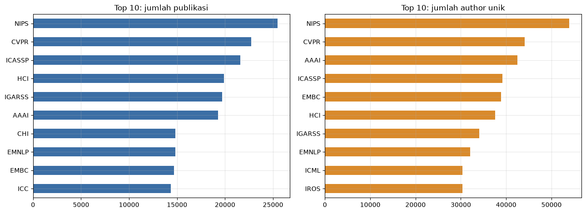

# Conference Popularity and Association Pattern Mining Using DBLP

Proyek Data Mining ini menganalisis publikasi konferensi dan lokakarya yang tercatat sebagai `inproceedings` di DBLP pada 2015–2025. Data setelah prapemrosesan mencakup 1.997.196 publikasi, 1.745.848 penulis unik, dan 4.372 venue.

[Notebook analisis](notebooks/DBLP_Association_Mining.ipynb) memuat metode, tabel, grafik, dan pembahasan dengan keluaran yang sudah tersimpan.

## Ringkasan hasil

NIPS (NeurIPS) menempati peringkat pertama berdasarkan jumlah publikasi dan jumlah penulis unik. Pada transaksi Author-Based, ICML dan NIPS merupakan pasangan yang paling sering muncul bersama. Apriori dan FP-Growth menghasilkan himpunan item yang sama pada keempat ambang *support*. FP-Growth lebih cepat pada ambang 0,1%, sedangkan Apriori lebih cepat pada ambang 0,5%, 1%, dan 2% dalam pengujian dengan `mlxtend`.



Lihat juga [tren publikasi per venue](output/figures/top-10-venue-publication-trends.png), [jumlah pola dan aturan menurut ambang support](output/figures/itemset-and-rule-counts-by-support.png), serta [tabel perbandingan algoritma](output/t6_performance.csv).

## Metode

Setiap venue diwakili oleh akronim dari kunci DBLP, misalnya `AAAI` dari `conf/aaai/...`. Transaksi Author-Based mencatat venue tempat seorang penulis pernah menerbitkan karya selama periode pengamatan. Transaksi Author-Year-Based mencatat venue untuk setiap pasangan penulis dan tahun.

Apriori dan FP-Growth diuji pada ambang *support* 0,1%, 0,5%, 1%, dan 2% untuk transaksi Author-Based. Aturan asosiasi menggunakan ambang *confidence* 50%. Analisis temporal membandingkan transaksi Author-Year-Based dalam empat periode dari 2015 hingga 2025.

## Struktur repositori

| Lokasi | Isi |
| --- | --- |
| [`notebooks/`](notebooks/) | Notebook utama beserta keluaran eksperimen |
| [`src/`](src/) | Skrip ekstraksi, prapemrosesan, penambangan pola, dan analisis |
| [`output/`](output/) | Tabel hasil dalam format CSV |
| [`output/figures/`](output/figures/) | Grafik dari keluaran notebook |
| [`requirements.txt`](requirements.txt) | Dependensi Python |

## Menjalankan analisis secara lokal

Buka [notebook di GitHub](notebooks/DBLP_Association_Mining.ipynb) untuk melihat hasil yang sudah tersimpan. Langkah di bawah digunakan untuk mengulang analisis dengan data DBLP.

### Siapkan lingkungan Python

Jalankan perintah berikut dari direktori utama repositori.

```bash
python3 -m venv .venv
source .venv/bin/activate
python -m pip install -r requirements.txt
mkdir -p data/raw
```

### Siapkan data DBLP

Simpan kedua berkas berikut dalam direktori `data/raw/`.

| Berkas | Lokasi |
| --- | --- |
| [Arsip XML DBLP](https://dblp.org/xml/dblp.xml.gz) | `data/raw/dblp.xml.gz` |
| [DTD DBLP](https://dblp.org/xml/dblp.dtd) | `data/raw/dblp.dtd` |

Sebagai catatan, eksperimen ini menggunakan arsip DBLP yang diunduh pada 19 November 2026. Pembaruan data DBLP dapat memengaruhi hasil pengulangan.

### Jalankan notebook

Buka notebook dengan perintah berikut, lalu jalankan sel dari atas ke bawah.

```bash
jupyter lab notebooks/DBLP_Association_Mining.ipynb
```

### Jalankan melalui terminal

Jalankan ketiga skrip berikut secara berurutan. Skrip analisis menggunakan Apriori dan FP-Growth dari `src/fpm.py`.

```bash
python src/extract.py
python src/preprocess.py
python src/analysis.py
```

Kedua cara menjalankan analisis dapat menimpa berkas hasil di `output/`.
